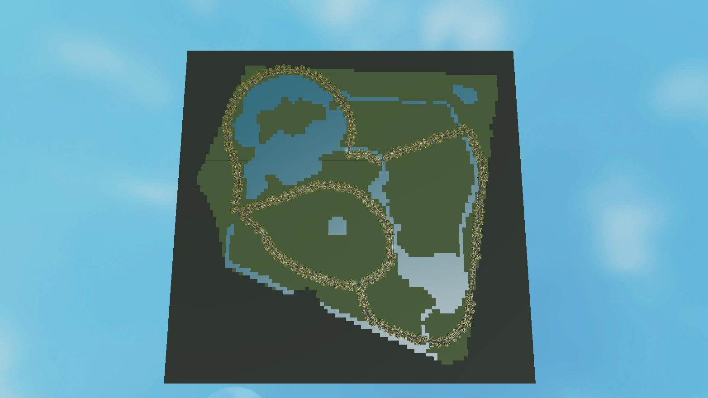
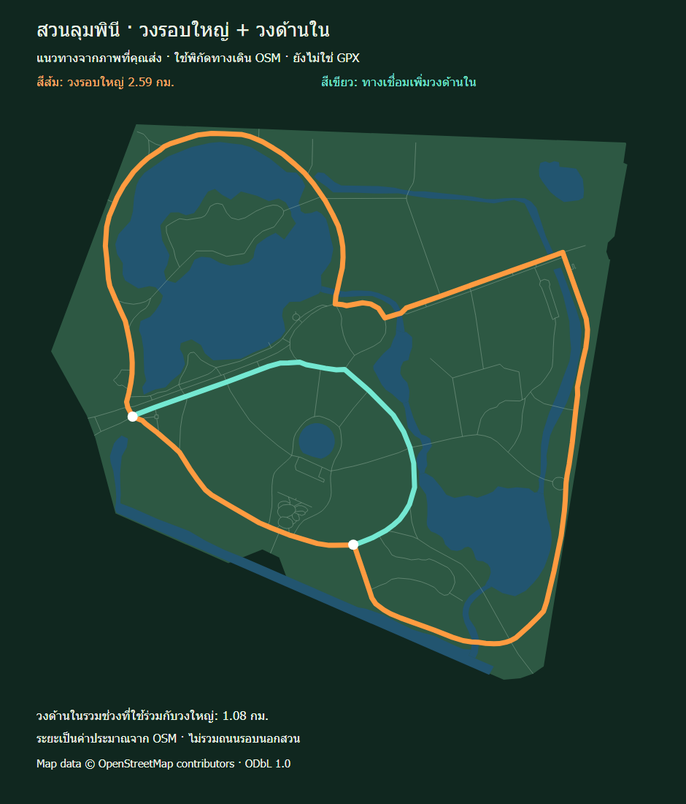

# Bangkok Running Demo

[](https://github.com/Muegoo/bangkok-running-demo/actions/workflows/ci.yml)

An **OpenStreetMap-to-Roblox pipeline** and playable running prototype for Bangkok parks. This portfolio snapshot selects one Lumphini Park demo with matching recorded Studio QA, alongside the source needed to inspect and regenerate its scene.



## Open the demo

1. Clone/download the repository.
2. In Roblox Studio, open [`demo/LumphiniStravaLayout.rbxlx`](demo/LumphiniStravaLayout.rbxlx).
3. Press **Play / F5**. Use **WASD** to move, right-drag to look and **V** to switch the camera.

The selected main circuit is approximately **2.59 km** and the inner circuit **1.08 km**. Coordinates come from OSM paths selected visually against a reference; these are approximate route choices, not a supplied GPS trace. Prototype speed is 20 studs/second at 2 studs/metre, not a human running-speed simulation.



## Engineering

```text
OSM source snapshots → GeoJSON layers → route selection / projection
                                        ↓
                               scene and mesh generation
                                        ↓
                                Roblox XML + Luau
                                        ↓
                           geometry checks / Studio playtest
```

- Polygon holes, clipping and closed-ring assembly preserve map geometry.
- Generated scene configuration separates route data from gameplay scripts.
- Luau handles movement, distance/time HUD, camera behavior and ambient runners.
- Build manifests and hashes connect the published place to recorded QA.
- No npm dependencies are required; Node.js 18+ is sufficient for the scripts.

## Validate and rebuild

```sh
npm test
npm run validate
npm run build
```

Validation is offline and uses the included snapshots. Rebuilding writes a new place and build manifest; it does **not** rerun Studio playtesting. Because serialization can differ from a place subsequently saved by Studio, rerun the gameplay checks and refresh the QA hash before treating a regenerated place as the tested release.

[`lumphini-strava-qa.json`](data/processed/lumphini-strava-qa.json) records a short Studio test from 17 October 2026. It covers movement, camera/HUD and route floor samples. It does not certify a complete running lap or mobile performance. CI checks geometry and artifact consistency, not live engine gameplay.

## Repository layout

| Path | Contents |
|---|---|
| `scripts/` | Map processing, scene generation, validation and optional local Studio tooling |
| `roblox/` | Luau gameplay sources and mesh metadata |
| `data/raw/` | OSM snapshots with source metadata |
| `data/processed/` | GeoJSON, selected scene, build manifest and QA |
| `demo/` | Selected playable place and route notes |
| `previews/` | Studio overview and route images |

Original personal reference screenshots, browser profiles/caches and older place backups are excluded.

## Data and asset credits

Map data **© OpenStreetMap contributors**, [ODbL 1.0](https://www.openstreetmap.org/copyright). Source URLs, dates and derived geometry are included. Keep the map attribution when sharing this demo.

Mesh references remain hosted on Roblox; account/group asset access may be required. Scenery widths, furniture, trees and skyline are artistic approximations. See [THIRD_PARTY_NOTICES.md](THIRD_PARTY_NOTICES.md) and [route notes](demo/LUMPHINI_STRAVA_LAYOUT.md).

No project-wide source-code license has been selected yet; third-party data and assets retain their own terms.
